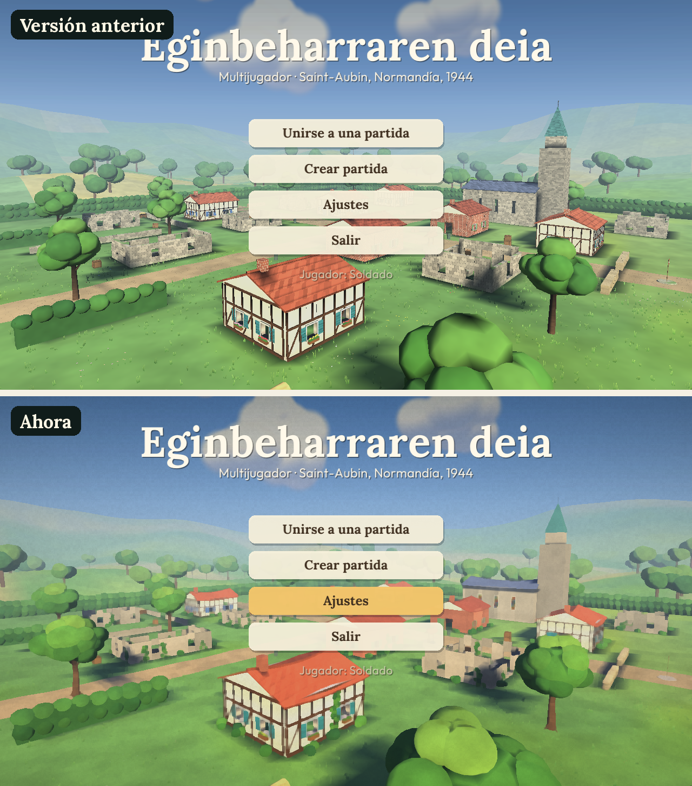
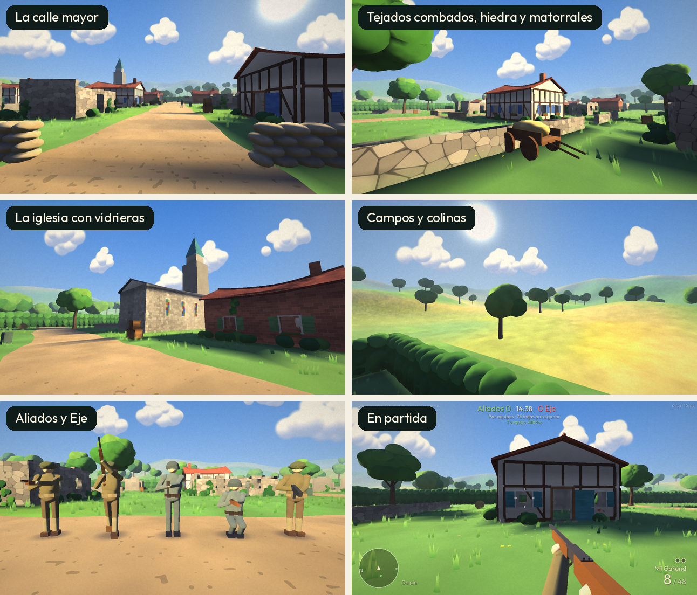

# Eginbeharraren deia

Shooter **multijugador en línea** de la Segunda Guerra Mundial, escrito en Rust e inspirado en
los clásicos de 2005. Aliados contra Eje en Saint-Aubin, un pueblo normando en ruinas.

- **Windows y Ubuntu**, con instaladores de doble clic.
- **Cuatro modos**: Todos contra todos, Por equipos, Buscar y destruir y Captura la bandera.
- **Como en los viejos tiempos**: cualquiera crea partida desde el menú o lanza un servidor
  dedicado; los demás entran por IP o la ven aparecer sola en la red local.

## Aspecto

Estilo de ilustración pintada, inspirado en el cine de animación: cielo azul con grandes
cúmulos, luz cálida de tarde con sombras suaves azuladas, prados con hierba que se mece y
flores, casas encaladas con entramado de madera normando, contraventanas, jardineras,
hiedra y matorrales, tejados de teja que se comban, muros que no son del todo rectos, una
iglesia con vidrieras, árboles como nubes de hojas y colinas con campos dorados alrededor
del pueblo. Encima, un filtro de pintura convierte la imagen en pinceladas (se puede quitar
en *Ajustes › Efecto de pintura* si el equipo va justo).

De serie todo se genera por código al arrancar y la luz se precalcula en menos de un
segundo.

### Modelos de artista

Para llegar al aspecto de las ilustraciones de referencia (`docs/referencias/`), el juego
carga **modelos glTF con texturas pintadas a mano**: soldados animados, armas en primera
persona, objetos y un escenario completo hecho en Blender (Carentan), con las colisiones y
los puntos de reaparición marcados por el nombre de los objetos. Se dibujan con sombreado de
anime (luz y sombra en dos tonos, con el borde nítido) y contorno de tinta. Lo que falte se
sigue dibujando como siempre. Qué hay que encargar o comprar y cómo prepararlo:
**[docs/modelos.md](docs/modelos.md)**.




## Instalar

Descarga el instalador de tu sistema desde la página **Releases** del repositorio:

| Sistema | Archivo | Notas |
|---|---|---|
| Windows | `EginbeharrarenDeia-…-Windows-Instalador.exe` | Crea accesos en el menú Inicio y el escritorio, y abre el cortafuegos para poder alojar partidas. También hay un `.zip` portable. |
| Ubuntu | `eginbeharraren-deia_…_amd64.deb` | Doble clic abre el Centro de aplicaciones; tras instalar, aparece en el menú de aplicaciones. Desde terminal: `sudo apt install ./eginbeharraren-deia_…_amd64.deb`. |

Windows puede mostrar el aviso de SmartScreen porque el instalador no está firmado:
pulsa *Más información › Ejecutar de todas formas*.

## Jugar

**En la misma red (casa, LAN party):** uno pulsa *Crear partida* y los demás entran en
*Unirse a una partida*, donde aparece automáticamente.

**Por internet:** quien aloja tiene que abrir (redirigir) el puerto **UDP 28960** de su router
hacia su ordenador y pasar su **IP pública** a los demás, que la escriben en *Unirse a una
partida › Dirección del servidor*. Puedes elegir otro puerto al crear la partida; entonces
los demás escriben `IP:puerto`.

**Servidor dedicado** (un PC o VPS siempre encendido, sin ventana):

```
eginbeharraren-deia-server --nombre "Mi servidor" --max 20 --modos tdm,hq,sd,ctf --bots 12 --aliados britanicos
```

| Opción | Significado |
|---|---|
| `--nombre` | Nombre que ven los jugadores |
| `--puerto` | Puerto UDP (por defecto 28960) |
| `--max` | Jugadores máximos (2–20) |
| `--modos` | Rotación: `dm`, `tdm`, `sd`, `ctf`, `hq`, `zombis` |
| `--limite` | Límite de puntuación (sustituye al del modo) |
| `--tiempo` | Límite de tiempo en minutos |
| `--bots` | Rellenar con bots hasta ese número de jugadores (ceden su sitio a los humanos) |
| `--nivel-bots` | 0 novatos, 1 regulares, 2 veteranos, 3 élite |
| `--aliados` | Nación aliada: `eeuu`, `britanicos` o `rusos` (el Eje siempre es Alemania) |

En Windows hay un acceso «Servidor dedicado de Eginbeharraren deia» en el menú Inicio (edita
`servidor-dedicado.bat` para cambiar opciones). En Ubuntu, `eginbeharraren-deia-server` en una terminal.

### Modos

| Modo | Reglas |
|---|---|
| Todos contra todos | Gana el primero en llegar a 30 bajas (10 min). |
| Por equipos | Aliados contra Eje, 75 bajas (15 min). |
| Buscar y destruir | Rondas sin reaparición, 2 min 30 s. Los atacantes colocan la bomba (mantener F, 5 s) en el objetivo A o B; los defensores la desactivan (7 s) antes de 45 s. También se gana eliminando al otro equipo. Cambio de papeles a las 3 rondas; gana quien llegue a 4. Los caídos ven la ronda desde un compañero. |
| Captura la bandera | Roba la bandera enemiga y llévala a tu base con la tuya en casa. Si muere el portador, cae; un compañero la devuelve tocándola o vuelve sola en 30 s. 5 capturas (15 min). |
| Cuartel General | Aparece una radio en algún punto del pueblo. El primer equipo que se queda 8 s a su lado la toma y suma un punto cada 2 s; el enemigo la destruye quedándose 8 s sin defensores cerca. A los 90 s se traslada. Quien tiene el cuartel tarda más en reaparecer. 150 puntos (15 min). |
| Zombis | Cooperativo: todos contra oleadas de zombis cada vez más numerosos, duros y rápidos. Quien cae vuelve en la siguiente oleada; si caen todos, se acaba. |

La partida empieza cuando hay al menos dos jugadores (uno por equipo en los modos por equipos),
o en cuanto entras si hay bots; mientras tanto se juega en calentamiento. Al acabar, marcador
final y siguiente modo de la rotación. Caben hasta 20 jugadores.

### Bots

Al crear partida se elige cuántos bots rellenan los huecos y su nivel. Se mueven por el mapa,
buscan cobertura cuando están heridos o recargando, flanquean, lanzan granadas a quien se esconde,
huyen de las granadas y avisan al equipo («¡Recargo! ¡Cubridme!», «¡Flanqueo por la
izquierda!»). Juegan los objetivos de cada modo (bomba, banderas, cuartel) y dejan su sitio
cuando entra una persona.

### Naciones, clases y armas

El Eje es siempre Alemania; los Aliados pueden ser estadounidenses, británicos o soviéticos
(se elige al crear la partida), cada uno con su uniforme, su casco y sus armas. Con la tecla **L**
eliges arma principal, arma secundaria (la pistola u otra arma de tu
nación) y ventaja. Si aún no has combatido desde que apareciste, el cambio es inmediato.

| Clase | Estados Unidos | Reino Unido | Unión Soviética | Alemania |
|---|---|---|---|---|
| Fusilero | M1 Garand · M1903 Springfield · M1 Carbine | Lee-Enfield | Mosin-Nagant · SVT-40 | Kar98k · Gewehr 43 |
| Asalto | Thompson · M3 Grease Gun | Sten · Sten Mk V | PPSh-41 · PPS-43 | MP40 · StG 44 |
| Apoyo | BAR | Bren | DP-28 | FG 42 |
| Francotirador | Springfield con mira | Lee-Enfield con mira | Mosin-Nagant con mira | Kar98k con mira |
| Pistola | Colt M1911 | Webley | Tokarev TT-33 | Luger P08 · Walther P38 |
| Ametralladora montada | M1919 Browning | Vickers | Maxim | MG42 |

**Ametralladoras montadas:** en los nidos tras los sacos terreros de cada bando. Acércate y pulsa
**F** para usarla (y otra vez F o salta para soltarla): gira hasta unos 60° a cada lado, no se
acaba la munición pero el cañón se recalienta si disparas demasiado seguido. En los escenarios de
Blender se colocan con objetos llamados `AMETRALLADORA_ALIADOS` o `AMETRALLADORA_EJE`.

**Armas en el suelo:** quien cae deja el arma que llevaba en la mano con su munición. Pasando
por encima de un arma igual a una de las tuyas coges su munición; con **F** cambias el arma que
llevas en la mano por la del suelo (y dejas la tuya).

**Granadas:** cada nación tiene la suya (Mk 2, Mills, RG-42 y la de mango alemana), y todos llevan
además una **granada de humo** (tecla **H**) que tapa la vista durante 24 s, también a los bots.
**Culatazo** con **V** (o el botón central del ratón): mata de un golpe a quemarropa.

Cada arma tiene su cadencia, su daño y su retroceso (vertical y lateral). Con la mira
telescópica el pulso se mueve: agáchate o aguanta la respiración con **Shift**.

**Ventajas:** Granadero (una granada más), Pulmones de acero (corres el doble), Cartucheras
(+50 % de munición), Manos rápidas (recargas un 30 % antes), Pulso firme y Piel dura (−20 % de
daño de bala). Como en CoD2, no hay rangos ni desbloqueos: todo está disponible desde el principio.

**Sin barra de salud**, como en CoD2: al recibir daño la pantalla se tiñe de sangre, se
emborrona y oyes el corazón; si te cubres unos segundos te recuperas. Las granadas que caen
cerca aparecen señaladas y se pueden **devolver con F**. Al morir, la cámara se separa de tu
cuerpo y se vuelve hacia quien te ha abatido. Los disparos y explosiones suenan a izquierda o
derecha según de dónde vengan.

### Controles

| Tecla | Acción |
|---|---|
| WASD | Moverse |
| Ratón | Mirar · clic izquierdo dispara · clic derecho apunta con la mira |
| R | Recargar |
| 1 / 2, Q o rueda | Cambiar de arma |
| G | Granada |
| F | Devolver una granada · mantener: colocar / desactivar bomba |
| L | Equipamiento: clase, arma, pistola y ventaja |
| V o botón central | Culatazo |
| H o 4 | Granada de humo |
| F junto a un nido | Usar / soltar la ametralladora montada |
| Shift con la mira telescópica | Aguantar la respiración |
| C o Ctrl | Agacharse · Espacio salta · Shift corre |
| Tab | Marcador |
| T / Y | Chat a todos / a tu equipo |
| M | Cambiar de equipo |
| Esc | Menú (sensibilidad, desconectar) |

Nombre, sensibilidad, campo de visión, volumen e inversión del ratón se guardan en *Ajustes*.

## Cómo se generan los instaladores

Los compila GitHub gratis en sus máquinas Windows y Ubuntu (flujo
`.github/workflows/instaladores.yml`):

1. Crea un repositorio en GitHub y sube el proyecto:
   ```
   git remote add origin https://github.com/TU_USUARIO/eginbeharraren-deia.git
   git push -u origin main
   ```
2. Publica una versión:
   ```
   git tag v0.2.0
   git push origin v0.2.0
   ```
3. En unos 10 minutos aparecen los instaladores en la pestaña **Releases**. También se puede
   lanzar a mano en *Actions › Instaladores › Run workflow* (los archivos quedan como
   artefactos de esa ejecución).

Para una versión nueva, sube el número en `Cargo.toml` y crea la etiqueta correspondiente.

## Compilar desde el código

```
cargo run --release                       # el juego
cargo run --release --bin eginbeharraren-deia-server # el servidor dedicado
cargo test --release                      # pruebas de red
```

Para revisar los gráficos sin jugar: `DEIA_CAPTURA=capturas cargo run --release` abre una
partida local con bots, coloca la cámara en varios sitios y guarda imágenes en esa carpeta.

En Ubuntu hacen falta antes: `sudo apt install pkg-config libx11-dev libxi-dev libgl1-mesa-dev libasound2-dev`.

## Cómo funciona la red

- **Servidor autoritativo** a 60 ticks/s sobre UDP; envía 20 instantáneas por segundo.
- **Predicción en el cliente**: tu movimiento se simula al instante con el mismo código que usa
  el servidor y se reconcilia en cuanto llega su respuesta, así que no notas el ping al moverte.
- **Interpolación** de los demás jugadores 100 ms en el pasado, para que se muevan suaves.
- **Compensación de lag**: al disparar, el servidor rebobina a los demás hasta el instante que tú
  veías. Acertar donde ves es acertar.
- Eventos fiables (bajas, chat, avisos) sobre UDP con confirmación; comandos redundantes contra
  pérdidas de paquetes; límite de comandos por tick contra trampas de velocidad.

`tests/red.rs` levanta un servidor real y varios clientes por UDP en 127.0.0.1. Juega partidas
completas con bots (por equipos, todos contra todos y buscar y destruir) y prueba capturas de
bandera, colocación, desactivación y explosión de la bomba. También comprueba la predicción, el chat,
las desconexiones, el servidor lleno y la compensación de lag. Con un objetivo en movimiento
acierta 8 de 8 disparos con compensación, frente a 2 de 8 sin ella.

## Estructura

| Archivo | Contenido |
|---|---|
| `src/main.rs` | El juego: menús, entrada, dibujado, HUD, sonido (macroquad) |
| `src/bin/eginbeharraren-deia-server.rs` | Servidor dedicado |
| `src/server.rs` | Servidor: conexiones, modos, reapariciones, compensación de lag |
| `src/client.rs` | Cliente: conexión, predicción, interpolación, búsqueda en red local |
| `src/net.rs` | Protocolo binario y mensajes |
| `src/sim.rs` | Simulación compartida: movimiento, armas, granadas |
| `src/world.rs` | Mapa, colisiones, rayos, navegación |
| `src/bots.rs` | Inteligencia de los bots: percepción, cobertura, flanqueo, granadas, objetivos y zombis |
| `src/model.rs` | Cargador glTF 2.0 (mallas, texturas, esqueletos, animaciones) y catálogo de modelos |
| `src/arte.rs` | Modelos de artista en el juego: sombreado de anime, contorno, soldados, armas, escenario |
| `src/geo.rs` | Escenario, personajes y objetos generados por código; luz precalculada |
| `src/shader.rs` | Sombreadores: luz, cielo, nubes, bruma, viento, detalle de cada material y filtro de pintura |
| `src/sfx.rs` | Sonidos sintetizados |
| `src/config.rs` | Ajustes guardados |
| `assets/fonts/` | Tipografías Lora y Outfit (licencia SIL OFL, incluida) |
| `packaging/` | Instaladores de cada sistema |
